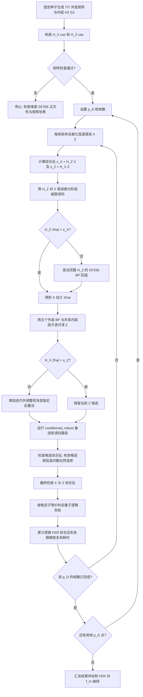

# GF(256) 级联码联合译码实验

## 一条命令生成 Z 偏置噪声下的 FER 曲线

```bash
cd /home/ypc/Projects/ldpc/git-demo
python3 experiments/gf256_cascade/run_z_bias_fer_curve.py
```

脚本固定使用 `results/g2_basis_path_n12_300frames/path/build` 中的
GF(256)、内层长度 12 的 `path` 矩阵，运行 `conditioned_robust_adaptive`
译码器。默认扫描总物理 Pauli 错误率
`p=0.060,0.065,0.070,0.075` 与 Z 偏置 `eta=1,3,10`，每点 100 帧。
这是定位曲线区间的预扫描；需要更精确的低 FER 时应增大帧数，并为
新参数指定新的 `--run-dir`。

```bash
python3 experiments/gf256_cascade/run_z_bias_fer_curve.py \
  --biases 1 3 10 --p-values 0.060 0.065 0.070 0.075 \
  --frames-per-point 500 --batch-size 5 --workers 4 \
  --run-dir experiments/gf256_cascade/results/z_bias_fer_curve_n12_path_500
```

这里 `eta=p_Z/p_X` 且 `p_X=p_Y=p/(eta+2)`、`p_Z=eta*p/(eta+2)`；
`eta=1` 等于原来的退极化信道。`p` 是总错误率，不是 `f_m`；偏置
信道下 X、Z 边缘翻转率不同。该 `eta` 定义也不同于 Tuckett 等人 Fig. 2
使用的 Y 偏置定义。

运行结束会在 `--run-dir` 生成 `source_data.csv`、
`fer_vs_p_z_bias.png/.pdf/.svg`、`figure_notes.md`、`run_config.json` 和
逐批日志。相同参数重新运行会复用已完成的批次；参数或程序发生变化时
应更换运行目录。图左侧为量子逻辑 FER，右侧为 Z 综合征失败比例；
零失败点用空心倒三角标注单侧 95% 上限，不代表 FER 恰为零。

## 当前仿真流程框架

### 可选的带状内层生成矩阵

构造器最后一个可选参数可选择 `star`（默认）或 `path`。两者均为
`H2=[1,1,1,1,1,1]` 对应的 `[6,5,2]` 单奇偶校验内码的生成矩阵：

~~~text
G2_star = [1 | I5]
G2_path = [
  1 1 0 0 0 0
  0 1 1 0 0 0
  0 0 1 1 0 0
  0 0 0 1 1 0
  0 0 0 0 1 1
]
~~~

带状形式的第 `a` 个外层投影为 `u[j,a]=z[j,a]+z[j,a+1]`。
两组生成矩阵的行空间相同，因此 `H_X` 校验行空间、量子码、码长和
码率相同；`H_Z` 也完全相同。不同的是外层 BP 所见的投影基及内层
因子图。模拟器对两种矩阵分别检查结构，并在带状模式下用链式
sum-product 消息传递、条件投影候选及链式物理符号重建。现有文档
其他位置的 `[1|I5]` 公式和历史结果仍指默认 `star` 基线。

配对比较脚本：

```bash
python3 experiments/gf256_cascade/run_g2_basis_comparison.py \
  --frames 20 --seed 20268000 --p-depolar 0.07125 \
  --run-dir /tmp/g2_path_comparison
```

脚本检查两组外层矩阵与 `H_Z` 完全一致，计数 GF(256) 符号层面的
`H_X` Tanner 四环，并输出综合征失败、逻辑 FER 与逐帧配对结果。
20 帧的首轮结果见 [G₂ 带状基配对报告](results/g2_basis_path_20261027/report.md)。

内层长度也可直接设为 12，并在同长度下比较两个 `G₂` 基：

```bash
python3 experiments/gf256_cascade/run_g2_basis_comparison.py \
  --inner-length 12 --frames 20 --seed 20268100 \
  --p-depolar 0.07125 --run-dir /tmp/g2_path_comparison_n12
```

此时 `H₂` 是 `1×12` 的全 1 行，两个 `G₂` 都是 `11×12`；
内码仍为单奇偶校验码，最小距离为 2。增加列长改变了整个量子码的
物理长度与码率，不能将长度 6 和长度 12 的 FER 差异全部归因于
`G₂` 的形状。
这组长度 12 的配对结果见 [实验报告](results/g2_basis_path_n12_20261027/report.md)。

### 长度 12 的几百帧实验

为确认 20 帧中的差异是否稳定，可用分批脚本在同一个 `p_D` 下对
系统式和带状 `G₂` 各跑 300 帧：

```bash
cd /home/ypc/Projects/ldpc/git-demo
cmake -S . -B /tmp/gf256_cascade_build -DCMAKE_BUILD_TYPE=Release
cmake --build /tmp/gf256_cascade_build --target gf256_cascade_construct gf256_cascade_simulate -j 4
python3 experiments/gf256_cascade/run_g2_basis_batched.py \
  --inner-length 12 --frames 300 --batch-size 5 \
  --p-depolar 0.07125 --seed-start 20268300 --workers 2 \
  --run-dir experiments/gf256_cascade/results/g2_basis_path_n12_300frames
```

`--frames 300` 指两种 `G₂` **各** 300 帧；`--batch-size 5` 使每组
分成 60 批。每批两种矩阵使用相同信道种子，终端逐批显示进度。
相同命令再次运行会复用已完成且输入、程序哈希、矩阵哈希均一致的批次。
结果保存在运行目录的 `aggregate_summary.json`、`aggregate_summary.csv`
以及逐批日志中。若编译程序发生变化，应使用新的运行目录。

根据本机 20 帧配对实测，单进程跑完 300 帧约需 2.8 小时的总译码时间；
`--workers 2` 的实际墙钟时间可先按约 1.5–3 小时预留，取决于并行负载。

### 12 列级联码的 Z 侧投影消融

新增 `conditioned_projection_independent` 对照模式：各外层投影只用自身的
信道边缘先验运行一次 GF(256) 软 BP（默认 20 次迭代），不在投影之间
交换 Turbo 消息；最后仍按相同内层关系重建物理 Z 符号。可用环境变量
`GF256_INDEPENDENT_OUTER_ITERS` 调整单个外层译码器的迭代次数。
同一批 40 帧、`p_D=0.07125`、12 列 `path` 矩阵上的结果：独立投影
逻辑失败 40/40，原联合稳健译码 9/40，自适应联合译码 4/40。
[配对数据和诊断](results/projection_independent_paired_n12_path_40/report.md)
说明该独立基线在这个工作点明显不足；它没有稳健回退，因此不能把
全部差异单独归因于投影间消息交换。

[详细对照报告](results/g2_basis_path_n12_300frames/projection_ablation_20261028.md)记录了同一批 300 帧上的失败定位。`conditioned_fullhx_bp` 保留相同的 X 侧译码和条件信道先验，直接对完整 `H_X` 做 GF(256) BP，省去 Z 侧的分阶段外层投影译码。在已检查的 star 失败帧及 path 前三帧上，它均未通过 Z 综合征，其中 path 原本成功的两帧也失败；这只是单帧诊断，不能当作总体 FER。

`conditioned_robust_adaptive` 则保持原译码流程，仅在 Z 综合征失败后尝试更长、低阻尼的迭代。对旧 300 帧中原本 Z 综合征失败的帧逐一重放后，star 救回 21/38，逻辑失败由 39/300 降至 18/300；path 救回 36/43，逻辑失败由 45/300 降至 9/300。该模式在原结果综合征通过时不替换候选，因此可从失败帧重放精确推得同批 300 帧结果。这是用于开发译码器的旧样本。

在新的 50 帧配对信道样本（种子 `20269000`–`20269009`）上，path 基线失败 8/50，自适应失败 2/50；6 帧救回、0 帧退化，配对精确检验双侧 p 值为 0.03125。译码 CPU 时间从 25.52 增至 29.12 秒/帧。此结果仅覆盖一组矩阵和一个 `p_D`，详见同一[对照报告](results/g2_basis_path_n12_300frames/projection_ablation_20261028.md)。

重放脚本会记录模拟器与矩阵哈希，并跳过目标帧的诊断专用 oracle 计算：

```bash
python3 experiments/gf256_cascade/replay_z_failures.py \
  --basis path --mode conditioned_robust_adaptive --workers 2 \
  --run-dir experiments/gf256_cascade/results/g2_basis_path_n12_300frames/replay_adaptive_path_all
```

若要对这组 12 列矩阵运行**新的**基线／自适应配对帧，可用：

```bash
python3 experiments/gf256_cascade/run_paired_decoder_study.py \
  --p-depolar 0.07125 --frames-per-point 50 --batch-size 5 \
  --seed-start 20269000 --workers 2 \
  --modes conditioned_robust conditioned_robust_adaptive \
  --matrix-dir experiments/gf256_cascade/results/g2_basis_path_n12_300frames/path \
  --inner-length 12 --allow-custom-matrices \
  --run-dir experiments/gf256_cascade/results/g2_basis_path_n12_300frames/fresh_path_50
```

下图对应本目录的 `conditioned_robust` 级联码仿真流程。X、Z 错误分别使用 `H_Z`、`H_X` 计算综合征；真实错误只用于最终评估，不进入译码器。



其中 `f_m = 2 p_D / 3`。X 路径会检查完整 `H_Z` 综合征；Z 路径先检查 `H_X` 综合征，失败时重试，最后再共同检查两侧。主指标是量子逻辑 FER；综合征失败率、精确恢复率和运行时间用于诊断译码过程。

### 为什么两侧的译码结构不同

对 X 错误，`H_Z^cas` 的上块含有选择矩阵 `[I_5 | 0]`：先用外层校验逐个译出 5 个投影，再由下块 `I ⊗ H_2` 恢复被选择矩阵漏掉的第 6 个符号。`decode_cascade_x` 组装完整估计后，会直接检查 `H_Z^cas xhat = s_X`；不通过时，`conditioned_robust` 流程还会尝试完整 `H_Z^cas` 的 GF(256) BP 回退。

对 Z 错误，`H_X^cas = H_Z^TIT ⊗ G_2`，其中 `G_2 = [1 | I_5]`。五个外层约束分别作用于投影 `z_0 + z_a`，而这五个投影共享同一个内层符号 `z_0`。因此当前代码没有把五条投影各自硬译完再独立拼接，而是用五个外层软 BP 与共享内层因子交换软信息，并结合已译 X 的去极化信道条件先验迭代。这是对 `H_X` 级联结构的联合软译码。

Z 的综合征检查确实存在：初次 Turbo 译码后检查完整 `H_X^cas zhat = s_Z`，不通过会以更多迭代和不同阻尼重试；`conditioned_robust` 还会生成备选路径并检查综合征。若两条候选都通过，再按信道对数似然选择。最后仍统一检查 X、Z 两侧综合征，再进行稳定子等价的逻辑失败判定。

这个目录保存 GF(256)、`P=97`、内层长度 6 的可复现实验。构造程序使用
`seed=20261018` 时，外层矩阵为 `H_Z^TIT`（194×582）和 `H_X^TIT`
（尺寸见构造日志）。级联矩阵为

\[
H_X^{\rm cas}=H_Z^{\rm TIT}\otimes G_2,\qquad
H_Z^{\rm cas}=\begin{bmatrix}
H_X^{\rm TIT}\otimes[I_5\mid0]\\
I_{582}\otimes H_2
\end{bmatrix},\quad H_2=[1,1,1,1,1,1].
\]

实际高斯消元得到的 `G2` 是 `[1 | I_5]`：第 `a` 行在内层第 0 列和
第 `a+1` 列为 1。因此 Z 错误的投影是 `u[j,a]=z[j,0]+z[j,a+1]`。
本次矩阵有 3492 个 GF(256) 符号，即 27,936 个物理量子比特；
`H_X^cas` 为 970×3492，`H_Z^cas` 为 1552×3492。两者满行秩且正交，
故量子码率为 `(3492-970-1552)/3492=970/3492≈0.278`。
模拟器逐行检查 `H_X^cas` 是否确实采用这个 `G2`；若改变生成矩阵，
条件译码会报错退出，需先重新推导内层因子。

## 本次实验的矩阵分块与尺寸

构造种子为 `20261018` 时，两个 TIT 外层校验矩阵尺寸都为 `194×582`，且在 GF(256) 上秩均为 194。内层矩阵定义为：

~~~text
H2 = [1 1 1 1 1 1]          (1×6)
S  = [I5 | 0_(5×1)]         (5×6)
G2 = [1_(5×1) | I5]         (5×6)
~~~

这里 `1_(5×1)` 表示 5 维全 1 列向量；因此 `G2` 的每一行在第 0 列和对应的一个后续列上为 1。并且 `H2 G2^T = 0`（GF(256)）。

级联校验矩阵的完整结构为：

\[
H_X^{\rm cas}=H_Z^{\rm TIT}\otimes G_2
\in\mathrm{GF}(256)^{970\times3492},
\]

\[
H_Z^{\rm cas}=
\begin{bmatrix}
H_X^{\rm TIT}\otimes S\\
I_{582}\otimes H_2
\end{bmatrix}
\in\mathrm{GF}(256)^{1552\times3492}.
\]

构造代码中的名字对应为 `hz_tit_outer_for_hx = H_Z^TIT`、`hx_tit_outer_for_hz = H_X^TIT`。也就是说，TIT 的 `H_Z^TIT` 用于构造最终 `H_X^cas`；TIT 的 `H_X^TIT` 用于构造最终 `H_Z^cas` 的上半部分。

- `H_X^cas`：尺寸 `970×3492`。每个内层块的五个投影为 `z[j,0]+z[j,a+1]`（`a=0,…,4`），然后由外层 `H_Z^TIT` 校验。
- `H_Z^cas` 上半部分：`H_X^TIT ⊗ S`，尺寸 `970×3492`。它分别校验每个内层块的前五个符号；第六个符号所在列在该上半部分为零。
- `H_Z^cas` 下半部分：`I_582 ⊗ H2`，尺寸 `582×3492`。它逐块检查六个符号之和，可在前五个符号估计已知时求出第六个符号；随后仍须检查完整 `H_Z^cas` 综合征。

两张 GF(256) 矩阵都有 `3492=582×6` 列，即 3,492 个有限域符号。每个符号展开为 8 个二进制坐标后，物理码长是 27,936 个量子比特；二进制 `H_X`、`H_Z` 尺寸分别为 `7,760×27,936` 和 `12,416×27,936`。构造器会检查 GF(256) 正交性以及二进制展开后的 CSS 正交性。

## 译码方法

`cascade`：对 X 使用 `H_Z^cas` 的分阶段译码；对 Z 使用普通的
GF(256) BP。`structured`：Z 使用五个外层 BP 和共享第 0 个内层符号的
软因子，但 X/Z 信道先验分开。`conditioned`：先译 X，再用去极化信道的
条件概率向 Z 因子图传递信息：

\[
P(Z=1\mid X=0)=\frac{p_D/3}{1-2p_D/3},\qquad
P(Z=1\mid X=1)=\frac12.
\]

X 的 GF(256) 元素先转换回物理比特的迹对偶坐标，Z 先验使用物理比特的
多项式基坐标。条件模式目前传递的是 X 的硬判决。若 X 的分阶段结果未
通过综合征，就尝试对完整 `H_Z^cas` 进行一次 GF(256) BP；若仍未通过，
Z 才退回未条件化的先验。若 Z 首次联合迭代未通过综合征，再以更多迭代
重试，并把新消息的混合权重由 0.5 调为 0.7。两个回退都只在综合征失败
时触发。输出
`ExactXFrames`、`XFallbackSuccesses` 和 `ZSoftFallbackSuccesses` 可用于诊断。
`conditioned_robust` 在此基础上再运行一条固定 10 轮、每轮 10 次外层
迭代、混合权重 0.3 的路径。它即使中途通过综合征也继续传递软信息。
两条路径都通过综合征时，选择条件信道对数似然更大的 Z 候选；若只有
一条通过，就选择通过的候选。这个选择只使用已译出的 X、信道模型和
综合征，不使用仿真中的真实错误。代价是每帧多跑一条 BP 路径。

用于对照的 `conditioned_robust_fullhz` 模式每帧都对完整 `H_Z^cas`
运行一次 GF(256) BP，再使用相同的 Z 译码与稳健候选选择流程。这样
`H_Z` 的上、下校验都在同一个 BP 因子图中传递消息。它与默认模式的
区别仅在 X 译码：默认模式先分阶段译码，失败时才跑完整 `H_Z` BP；
对照模式则每帧直接跑完整 `H_Z` BP。结果中的
`XFullHzBpAttempts/Successes` 统计完整矩阵 BP 的调用次数及综合征通过数。
在 `p_D=0.06` 且 X 已知正确时，每位 Z 错误的条件熵约为 0.1803 bit，
低于未条件化的 0.2423 bit；对 27,936 个物理位约相差 1,733 bit。
这是信息量估算，不能单独推出译码成功率。

### Z 侧失败诊断（2026-10-25）

2026-10-26 的后续配对诊断见
[`results/refresh_probe_20261026/README.md`](results/refresh_probe_20261026/README.md)：
末轮外层消息刷新未救回同一批 10 帧中的 4 次 Z 失败；外层 OSD-0、
五投影联合评分和有限候选列表使综合征通过，但未降低这批帧的逻辑 FER。
这些模式目前是诊断对照，不能代替原译码器的性能结果。

在 `p_D=0.0675` 的 5,000 帧结果中，92 帧未通过 Z 综合征检查，X 侧失败为
0；Z 侧加长 Turbo 重试调用 201 次并挽回 97 次。重放其中一个失败帧
（seed `20262000`、trial `33`）时，X 估计与真实 X 错误完全相同，Z 仍留下
5 条未满足校验，且使用真实 X 作为先验也没有改变结果。这支持“Z 侧迭代
译码陷入局部收敛”，没有发现对应的矩阵尺寸、二进制展开或综合征分组错误。

在同一 50 帧随机序列上做了两个诊断对照：

- `conditioned_robust_long`：Z 侧重试增加到 60 轮。结果仍为 1/50 逻辑失败、
  1 次 Z 综合征失败，与默认译码相同。
- `conditioned_robust_osd`：只在 Z BP 失败后运行完整矩阵 BP + 一阶 OSD。
  它把该批次的 Z 综合征失败从 1 次降到 0 次，但逻辑失败仍为 1/50；
  原失败帧变成了“综合征通过、逻辑类错误”。因此不能把综合征通过单独当作
  译码改善，OSD 模式目前仅供诊断，不是默认推荐译码器。

这 50 帧只是配对诊断样本，不足以证明统计性能变化。主结果仍是
`conditioned_robust` 的 109/5000 逻辑失败，其中 92 次为综合征失败、17 次为
通过综合征后的逻辑失败。下一步若要改变结构，应优先比较更强的内层码：当前
`H2=[1,1,1,1,1,1]` 仅给出 GF(256) `[6,5,2]` 单奇偶校验码；更换为多行 `H2`
会同时改变 `G2`、选择矩阵、级联尺寸和译码因子，必须作为独立构造重新验证，
不能只替换矩阵文件。

当前外层 `H_Z^TIT` 的秩为 194。若五个投影分别译码，每个投影的
综合征只有 `194×8=1552` bit；在 `p_D=0.06` 时，投影比特的边缘错误率
为 `2×0.04×0.96=0.0768`，其 582 个 GF(256) 符号的熵约为 1820 bit。
这个差额说明独立切片译码的参数搭配不利。整体 `H_X^cas` 有
`970×8=7760` bit 综合征，上述总量没有明显短缺；利用共同的内层符号
以及 X/Z 信道相关性才有机会恢复 Z 分量。

## 运行

### 配对译码对照与计算量

`run_paired_decoder_study.py` 用同一矩阵、同一 `p_D`、同一种子和同一帧序列
分别运行 `conditioned_robust`、`conditioned_robust_adaptive`、
`conditioned_robust_long`。最后一种模式通过延长失败后的 Turbo 重试作为
“仅增加迭代”对照。汇总同时报告逻辑 FER、Wilson 95% 区间、Z 综合征失败、
综合征通过但逻辑失败、每帧 CPU 时间、救回与退化的配对帧数，以及双侧精确
McNemar 检验。`pairwise.csv` 还直接比较自适应和加长迭代的逐帧差异。
比较计算成本时，应直接看每帧 CPU 时间；三个模式的实际成本不保证相等。
固定验证的假设、种子和统计口径见 `paired_decoder_study_protocol.md`。
已完成的三点筛选和 `p_D=0.07125`、450 帧独立配对验证见
`results/paired_decoder_study/RESULTS_20261025.md`；该点的逻辑失败为
原译码器 64/450、自适应 43/450、加长迭代 46/450。自适应与加长迭代
之间的配对差异尚无统计证据，具体检验和 CPU 成本见结果记录。

```bash
python3 experiments/gf256_cascade/run_paired_decoder_study.py \
  --p-depolar 0.0675 0.07125 0.075 \
  --frames-per-point 500 --batch-size 50 --workers 4 \
  --run-dir experiments/gf256_cascade/results/paired_decoder_study/main_500
```

脚本逐批保存 TSV、失败帧日志和 CPU 时间；重用相同命令可续跑。矩阵哈希和
可执行文件哈希若变化，脚本会拒绝把新结果混入已有批次。`summary.csv` 可用来
比较曲线各点，但不应以同一批调参样本作为最终独立验证。若目标 FER 约为
`0.005`，为观察约 100 次失败，单点约需 20,000 帧；实际帧数应在初步扫描后
根据失败率和 CPU 时间重新估算。首次运行前先按下方命令编译。

从仓库根目录编译：

```bash
cmake -S . -B /tmp/gf256_cascade_build -DCMAKE_BUILD_TYPE=Release
cmake --build /tmp/gf256_cascade_build --target gf256_cascade_construct gf256_cascade_simulate -j 4
```

在单独的工作目录生成矩阵并运行；两个译码模式使用同一矩阵和随机种子：

```bash
mkdir -p /tmp/gf256_cascade_trial
cd /tmp/gf256_cascade_trial
/tmp/gf256_cascade_build/gf256_cascade_construct 20261018
/tmp/gf256_cascade_build/gf256_cascade_simulate 50 20261018 0.06 conditioned
/tmp/gf256_cascade_build/gf256_cascade_simulate 50 20261018 0.06 conditioned_robust
/tmp/gf256_cascade_build/gf256_cascade_simulate 50 20261018 0.06 conditioned_robust_fullhz
/tmp/gf256_cascade_build/gf256_cascade_simulate 10 20261018 0.06 cascade
```

同一矩阵与同一随机种子配对比较两种 X 译码时，分别运行
`conditioned_robust` 和 `conditioned_robust_fullhz`，并保持帧数及 `p_D`
相同。两次运行会生成相同的信道错误序列；汇总列中的 `Failures`、
`XSyndromeFailures`、`ZSyndromeFailures`、`ExactXFrames` 和运行时间可用于
比较。小帧数结果只适合诊断，不能据此估计低 FER。

只跑单个参数点时，可用 `--p-depolar` 和 `--frames` 覆盖默认 sweep。例如，
运行 5,000 帧、`p_D=0.0675`：

```bash
python3 experiments/gf256_cascade/run_gf256_cascade_sweep.py \
  --workers 4 --p-depolar 0.0675 --frames 5000
```

在生成矩阵的工作目录运行
`sha256sum -c /home/ypc/Projects/ldpc/git-demo/experiments/gf256_cascade/matrix_hashes.sha256`
可核对固定种子生成的四个关键 GF(256) 矩阵。

`p_D` 是每个物理量子比特的去极化错误率。`LogicalFailureRate` 检查最终
残差是否属于对应稳定子的行空间；`SyndromeFailures` 另行报告综合征失败。
构造器会检查 GF(256) 和二进制 CSS 正交性；模拟器会核对二进制展开与
GF(256) 矩阵一致。

## 已完成的诊断

固定矩阵、`p_D=0.06`、随机种子 `20261018`：

| 译码方式 | 帧数 | 逻辑失败 | Z 综合征失败 | X 精确恢复 |
| --- | ---: | ---: | ---: | ---: |
| 普通级联 BP | 10 | 10 | 10 | 10 |
| X 条件先验 + 内层联合因子 | 10 | 0 | 0 | 10 |
| X 条件先验 + 内层联合因子 | 50 | 0 | 0 | 50 |
| X 条件先验 + 内层联合因子，5 组种子合计 | 250 | 0 | 0 | 250 |

首组 50 帧中有 29 帧完整恢复了物理错误；其余 21 帧的残差通过了稳定子
等价判定。`0/250` 是有限样本观察，不能证明真实 FER 为零；对应的一侧
95% 置信上限约为 1.2%，还不足以断言达到 `10^-3` 等目标。若需要该精度，
应在固定参数下累计足够多的独立帧并报告置信区间。

2026-10-23 重新生成矩阵后，`conditioned` 在曾出现失败的三个随机种子
`20261025`、`20261026`、`20261029` 上各跑 350 帧，分别为 `1/350`、
`0/350`、`0/350`。合计 `1/1050` 次量子逻辑失败、0 次综合征失败；
唯一的失败是 `20261025` 第 212 帧的未检出逻辑错误。三组 X 分阶段
译码失败共 3 帧，完整 `H_Z` 回退都通过综合征；Z 软重试触发 1 帧并
通过综合征。

`conditioned_robust` 使用同一矩阵和 `p_D=0.06`，在随机种子
`20261018` 至 `20261022` 各跑 50 帧，在 `20261023` 至 `20261030`
各跑 350 帧，合计 **0/3050 量子逻辑失败、0/3050 综合征失败**。
精确单侧 95% FER 上限为 **0.000981725**；这说明目前的样本与
`FER < 10^-3` 相容，但不能证明真实 FER 为零。3050 帧中有 1789 帧
精确恢复了全部物理错误，其余成功帧通过稳定子等价判定。
X 分阶段失败 3 帧，完整 `H_Z` 回退均成功；Z 软重试成功 1 帧；
稳健路径被选中 1 帧，即 `20261025` 的第 212 帧。八组 350 帧各自的
失败数均为 0。每组使用独立的伪随机种子；置信界按帧独立抽样计算。
原始 TSV 和日志保存在 `results/`，可用 `summarize_results.py` 汇总。

```bash
python3 experiments/gf256_cascade/summarize_results.py \
  experiments/gf256_cascade/results/robust_2026101[8-9]_50.tsv \
  experiments/gf256_cascade/results/robust_2026102[0-2]_50.tsv \
  experiments/gf256_cascade/results/robust_2026102[3-9]_350.tsv \
  experiments/gf256_cascade/results/robust_20261030_350.tsv
```

三个小规模核对程序可直接运行：

```bash
python3 experiments/gf256_cascade/check_inner_factor.py
python3 experiments/gf256_cascade/check_small_map.py
python3 experiments/gf256_cascade/check_stabilizer.py
```

前者将五条内层软消息与 GF(4) 枚举比较；后者在两个内层块的二进制例子
中，对全部 32 种综合征比较完整枚举和分解计算的概率及精确 MAP 值。
第三个程序枚举 4096 个残差，核对快速分块稳定子判定和完整行空间。

若要复现某一帧，可传入最后一个零起始帧编号。前面的帧仍会采样以保持
随机序列一致，但跳过译码。例如 `20261025` 的第 212 帧：

```bash
/tmp/gf256_cascade_build/gf256_cascade_simulate 212 20261025 0.06 conditioned 211
```

该单帧诊断会打印候选与真实错误的似然差；真实错误只用于事后评估，
不会进入译码先验或候选选择。

20261025 的零起始第 211 帧是综合征通过但逻辑失败的诊断例。
`conditioned` 的 Z 候选比真实错误的条件对数似然低约 50.05；
`conditioned_robust` 的另一条路径给出通过综合征且逻辑正确的候选，
并按条件似然选择了它。3050 帧完整统计见上文。

### 完整 `H_Z` BP 初步配对试跑

固定矩阵种子 `20261018`，每个点都用相同的信道随机种子分别运行
`conditioned_robust`（分阶段）与 `conditioned_robust_fullhz`（每帧完整
`H_Z` BP）。目前每种方法仅 10 帧，结果只能用于初步诊断：

| `p_D` | X 译码方式 | 帧数 | 逻辑失败 | X 综合征失败 | Z 综合征失败 | 精确 X 恢复 | 完整 `H_Z` BP 成功/调用 | 耗时 |
| ---: | --- | ---: | ---: | ---: | ---: | ---: | ---: | ---: |
| 0.06750 | 分阶段 + 失败回退 | 10 | 0 | 0 | 0 | 10 | 2/2 | 78.02 s |
| 0.06750 | 每帧完整 `H_Z` BP | 10 | 0 | 0 | 0 | 10 | 10/10 | 76.79 s |
| 0.07125 | 分阶段 + 失败回退 | 10 | 1 | 0 | 1 | 10 | 3/3 | 133.52 s |
| 0.07125 | 每帧完整 `H_Z` BP | 10 | 1 | 0 | 1 | 10 | 10/10 | 128.74 s |

每一对译码看到相同的信道错误；两种方法的综合征失败数、精确恢复数、
平均物理错误数和平均残差符号数完全相同。`p_D=0.07125` 的唯一失败在
两种方法中都是同一帧的 Z 综合征失败。因此，这次试跑没有显示每帧完整
`H_Z` BP 带来 FER 改善；但 10 帧样本太小，不能据此断定两种方案性能相同。

随后对 `p_D=0.07125`、随机种子 `20261125` 的第 7 帧单独诊断了 Z 译码。
该帧 X 估计精确；当前 Turbo 及使用真实 X 的 Turbo 都只剩 5/970 个
`H_X^cas` 校验未满足。完整矩阵 BP 使用边缘先验时有 838 个未满足校验；
使用已译 X 的条件先验、最多迭代 200 次后仍有 125 个。详细数据与复现
命令见[单帧诊断记录](results/hx_z_diagnostic_20261024/frame_20261125_7.md)。
这指向 Z 侧消息传递或收敛问题，而不是该帧的 X 估计错误；单帧结果不能
代表总体 FER，也不能据此排除矩阵结构对译码难度的影响。又尝试了基于
条件先验的有限深度综合征修复（beam width 128、深度 12），仍停在 5 个
未满足校验。再对完整矩阵 BP 候选试了局部 OSD-1：以不满足的校验行为
局部方程，按后验可靠性选基并枚举至多 64 个最不可靠自由符号，连续四轮
把未满足校验从 125 降至 18，但仍未通过完整综合征检查。该后处理目前只
在单帧诊断分支使用，尚不能算成功译码或 FER 改善。
随后测试完整矩阵 OSD-1：以可靠性排序选出 970 个主元符号，固定其余
符号为 BP 硬判决，并枚举 256 个最不可靠自由符号的单符号替代，共检查
65,281 个候选。它找到了通过全部综合征的候选，但该候选不与真实错误稳定子
等价，仍是逻辑失败。真实错误只用于事后等价评估，不参与译码选择。因此
当前结果证明了 OSD 能修复这帧的综合征，不证明它改善了量子逻辑 FER。

## Z 侧失败诊断与自适应 Turbo 回退（2026-10-25）

矩阵保持原来的 GF(256) 构造：TIT 外层参数 `J=2, L=6, P=97,
sigma=35, tau=2`，构造种子 `20261018`；级联内码仍是
`H2=[1,1,1,1,1,1]`、`G2=[1|I5]`。本次只改译码路径，没有更换矩阵。
已有构造器和模拟器检查继续通过：GF(256) 的 CSS 正交性、二进制展开和
综合征映射均与矩阵定义一致；小规模精确 MAP 核验也通过。现有证据没有
指向矩阵文件损坏或域基映射错误，但不能据此断言级联矩阵已经最优。

单帧诊断显示，X 译码可精确恢复，而 Z 的 Turbo/BP 会因迭代调度不同而
停在不同候选上。仅把未满足校验修到零并不够：局部 OSD-1/2 曾找到满足
全部校验的候选，但它仍处在错误逻辑类。对同一难帧扫描 Turbo 设置时，
较低阻尼和更多外层 BP 迭代能找到稳定子等价正确的候选。这说明当前失败
主要表现为 Z 侧消息传递收敛和候选选择问题；矩阵结构仍可能影响其难度。

新增 `conditioned_robust_adaptive` 实验模式：先完整执行原有
`conditioned_robust` 流程；如果 Z 综合征仍不通过，再尝试 Turbo
`(rounds=10, outer_iterations=20, damping=0.2)`，若仍失败则尝试
`(20,20,0.2)`。仅在候选通过完整 `H_X^cas` 综合征检查时才替换结果；
最终仍按稳定子等价计算逻辑 FER。原模式的 Z 调度是 `10×10, damping=0.7`，
失败后 `20×20, damping=0.7`，并比较 `10×10, damping=0.3` 的稳健候选。

使用同一个当前构建版本、同一矩阵、`p_D=0.0675`，分别对种子
`20262000` 至 `20262007` 的每组 50 帧配对运行，共 400 帧：

| 方法 | 逻辑失败 | Z 综合征失败 | 综合征通过但逻辑失败 |
| --- | ---: | ---: | ---: |
| 原版 `conditioned_robust` | 9/400 (2.25%) | 8 | 1 |
| 新版 `conditioned_robust_adaptive` | 2/400 (0.50%) | 1 | 1 |

逐帧配对中，7 帧由失败变成功、0 帧由成功变失败、2 帧两种方法都失败，
其余 391 帧两种方法都成功。双侧精确 McNemar 检验 `p=0.015625`。
自适应回退共运行 9 次译码设置，其中 7 次得到通过综合征的候选；逻辑 FER
仍以稳定子等价为准，所以这不是把综合征通过直接当作成功。

这 400 帧结果支持自适应回退有改善，但它仍是中等规模的诊断实验：新版
还留下 1 次 Z 综合征失败和 1 次未检出的逻辑失败。论文结果仍需扩大帧数、
增加独立随机种子，并报告置信区间。配对汇总、逐批日志、参数扫描和 OSD
诊断保存在
[`results/z_decoder_diagnosis_20261025`](results/z_decoder_diagnosis_20261025)。

复现自适应版单批次（50 帧）：

```bash
cd /home/ypc/Projects/ldpc/git-demo/experiments/gf256_cascade/results/gf256_cascade_curve/run_20261025_001136/matrices
/tmp/gf256_cascade_build/gf256_cascade_simulate 50 20262000 0.0675 conditioned_robust_adaptive
```

当前版本的基线和自适应版都已在同一批 8 个种子上运行；汇总 CSV 中包含
每个种子的失败帧编号和回退调用/成功数。`conditioned_robust` 仍是原模式，
新模式作为可复现实验选项提供。

## 完整双向因子图 BP 的配对初测（2026-10-26）

新增 `joint_factorized` 实验模式：在完整 `H_Z^cas` 与 `H_X^cas` 图上，
以退极化信道联合因子在每轮 GF(256) BP 中双向交换 X/Z 概率消息。
它与现用 `conditioned_robust` 的分阶段 Z 译码结构不同，因而这个对比
检验的是**完整图联合 BP 这一具体实现**，不能隔离“是否同时译码”一个因素。

同一矩阵、`p_D=0.07125`、种子 `20265000` 的 20 帧配对初测：
`conditioned_robust` 为 1/20 逻辑失败；12 轮 `joint_factorized` 为
20/20，失败均在 Z 综合征，X 侧 20 帧都精确。联合模式首帧加至 50 轮仍
未通过 Z 综合征。详细参数、逐帧结果、可执行文件与矩阵哈希及解释见
[`results/joint_factorized_paired_20261026/REPORT.md`](results/joint_factorized_paired_20261026/REPORT.md)。
该小样本只用于排查完整图联合 BP，不能据此否定保留级联投影分解的
双向软信息方案。
